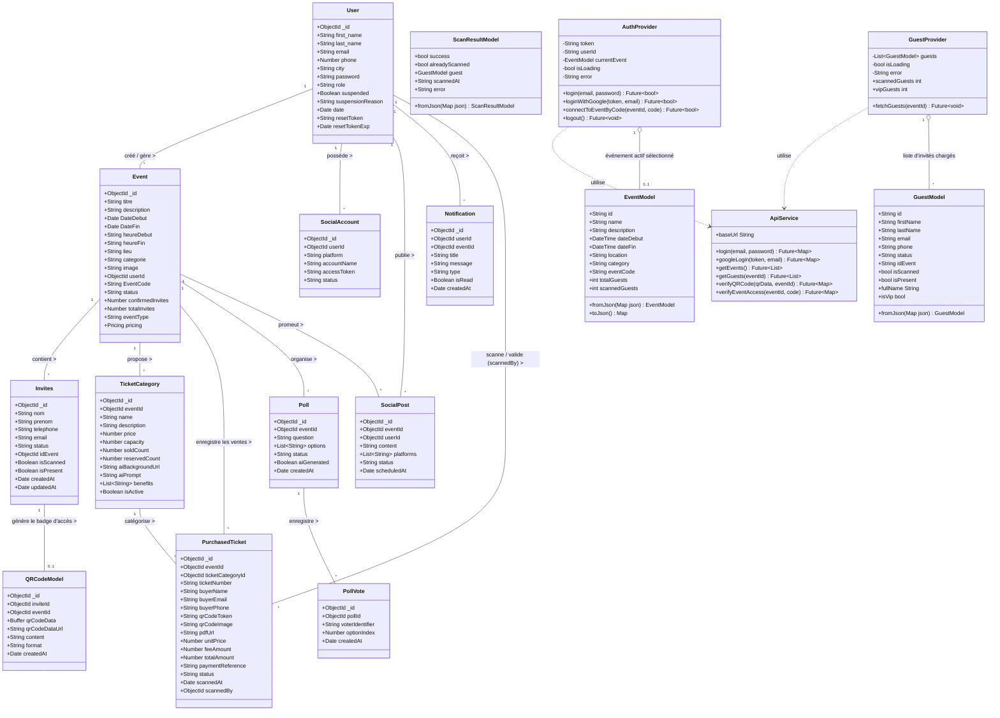

# Diagramme de Classes - Analyse UML du Projet ARSHI EVENT

Ce document présente l'analyse UML complète de la structure logicielle du projet **ARSHI EVENT**, englobant :
1. **L'Architecture Backend** (Modèles de données MongoDB / Mongoose, Contrôleurs et Services REST API).
2. **L'Architecture Mobile Flutter** (Modèles de données client, Providers de gestion d'état et Services API).
3. **Les Relations et Cardinalités** régissant le système de billetterie, de gestion d'événements, d'invitations et de contrôle d'accès par QR Code.

---

## 1. Diagramme de Classes Général (Mermaid)

---

## 2. Description Détaillée des Classes et Attributs

### A. Core Backend Models (MongoDB / Mongoose)

#### 1. `User` (Utilisateur & Organisateur)
- **Rôle** : Représente un compte utilisateur (Organisateur d'événement ou Administrateur système).
- **Attributs majeurs** :
  - `_id`: Identifiant unique MongoDB.
  - `first_name`, `last_name`: Nom complet de l'utilisateur.
  - `email`: Adresse email unique (sert d'identifiant de connexion standard ou Google).
  - `password`: Hachage sécurisé du mot de passe (Bcrypt).
  - `role`: Type de privilège (`'user'` | `'admin'`).
  - `suspended`: État de suspension du compte.
  - `resetToken`, `resetTokenExp`: Token et date d'expiration pour la réinitialisation de mot de passe.

#### 2. `Event` (Événement)
- **Rôle** : Représente un événement créé par un organisateur.
- **Attributs majeurs** :
  - `titre`, `description`, `lieu`, `categorie`: Informations descriptives.
  - `DateDebut`, `DateFin`, `heureDebut`, `heureFin`: Plage temporelle.
  - `userId`: Clé étrangère vers l'utilisateur créateur (`ref: 'user'`).
  - `EventCode`: Code secret alphanumérique à 8 caractères pour l'accès mobile des contrôleurs.
  - `eventType`: Type d'événement (`'private'` | `'public'`).
  - `status`: Échéance (`'en attente'`, `'en cours'`, `'terminer'`).
  - `pricing`: Structuration tarifaire de la billetterie publique et frais de canal.

#### 3. `Invites` (Invité Privé)
- **Rôle** : Fiche d'un invité sur la liste privée d'un événement.
- **Attributs majeurs** :
  - `nom`, `prenom`, `telephone`, `email`: Coordonnées du participant.
  - `status`: Catégorie d'invité (`'vip'` | `'classique'`).
  - `idEvent`: Clé étrangère vers l'événement concerné (`ref: 'event'`).
  - `isScanned`, `isPresent`: États booléens du contrôle d'accès en temps réel.

#### 4. `QRCodeModel` (QR Code de Validation)
- **Rôle** : Stocke les données de l'empreinte QR Code d'un invité.
- **Attributs majeurs** :
  - `inviteId`: Référence de l'invité (`ref: 'Invites'`).
  - `eventId`: Référence de l'événement (`ref: 'event'`).
  - `content`: Token / Empreinte unique encodée dans le QR Code.
  - `qrCodeData`: Image binaire (PNG Buffer).

#### 5. `TicketCategory` & `PurchasedTicket` (Billetterie Publique)
- **`TicketCategory`** : Définit les types de billets (Tarifs VIP, Standard, Early Bird, capacité max).
- **`PurchasedTicket`** : Billet individuel acheté publiquement avec numéro unique `ticketNumber`, jeton `qrCodeToken`, lien du PDF et statut (`'valid'`, `'scanned'`, `'cancelled'`).

---

### B. Mobile App Models (Flutter / Dart)

#### 1. `EventModel`
- Modèle Dart côté application mobile représentant l'événement auquel l'agent de contrôle est connecté.
- Gère la désérialisation JSON via `EventModel.fromJson()`.

#### 2. `GuestModel`
- Représente un invité dans la liste mobile avec propriétés calculées `fullName` et `isVip`.

#### 3. `ScanResultModel`
- Modèle de données encapsulant le résultat du scan d'un QR code (Succès, Déjà scanné, Invalide).

---

### C. Services & Management Layer (State & API)

#### 1. `AuthProvider` & `GuestProvider`
- Gèrent l'état réactif (`ChangeNotifier`) de la session, de l'authentification (Standard et Google), et de la synchronisation de la liste des invités.

#### 2. `ApiService`
- Fournit la couche d'abstraction réseau pour communiquer avec les API REST Node.js (`/api/auth/login`, `/api/auth/google`, `/api/scan/verify`, etc.).

---

## 3. Matrice des Relations UML

| Classe Source | Cardinalité | Classe Cible | Type de Relation | Description |
| :--- | :---: | :--- | :---: | :--- |
| **User** | `1` | **Event** | Association | Un utilisateur peut créer plusieurs événements (`userId`). |
| **Event** | `1` | **Invites** | Composition | Un événement contient une liste d'invités (`idEvent`). |
| **Invites** | `1` | **QRCodeModel** | Composition | Un invité possède un QR Code unique pour l'entrée (`inviteId`). |
| **Event** | `1` | **TicketCategory** | Agrégation | Un événement propose des catégories de billets (`eventId`). |
| **TicketCategory** | `1` | **PurchasedTicket** | Association | Une catégorie est associée à plusieurs billets achetés. |
| **User** | `1` | **PurchasedTicket** | Association | Un contrôleur (User) effectue le scan d'un billet (`scannedBy`). |
| **AuthProvider** | `1` | **EventModel** | Agrégation | L'AuthProvider maintient l'événement sélectionné en cours. |
| **GuestProvider** | `1` | **GuestModel** | Agrégation | Le GuestProvider gère la collection des invités filtrables. |
