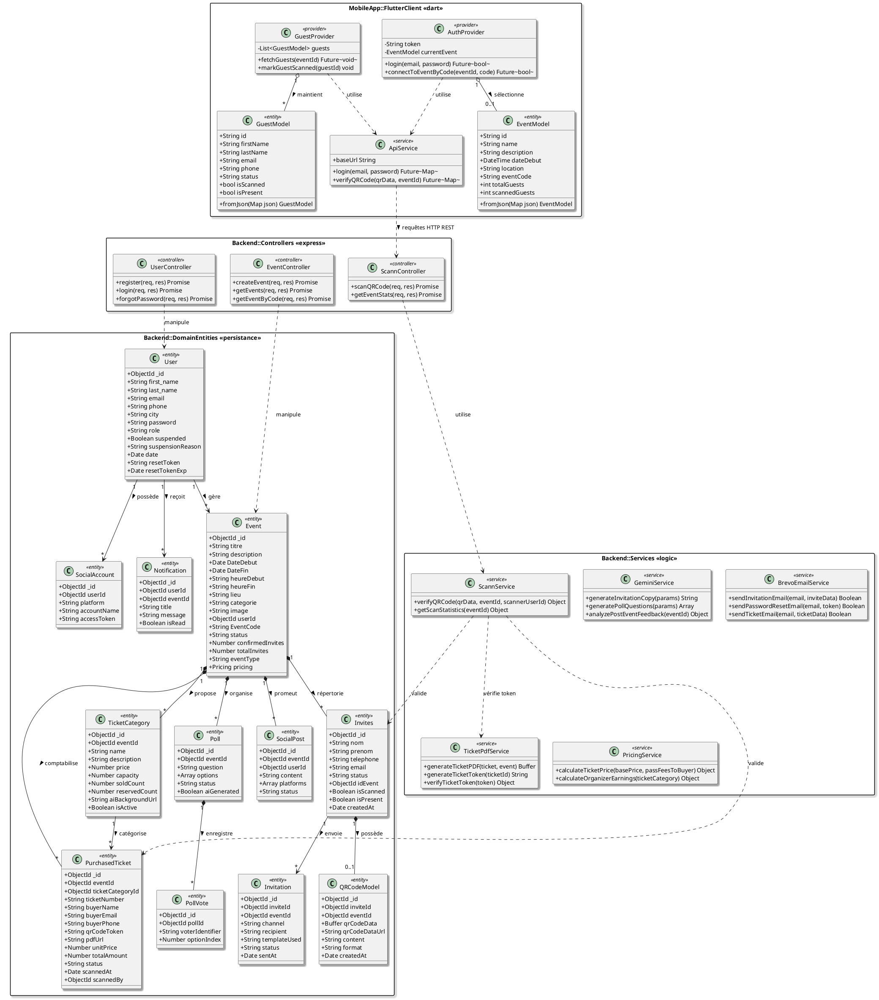
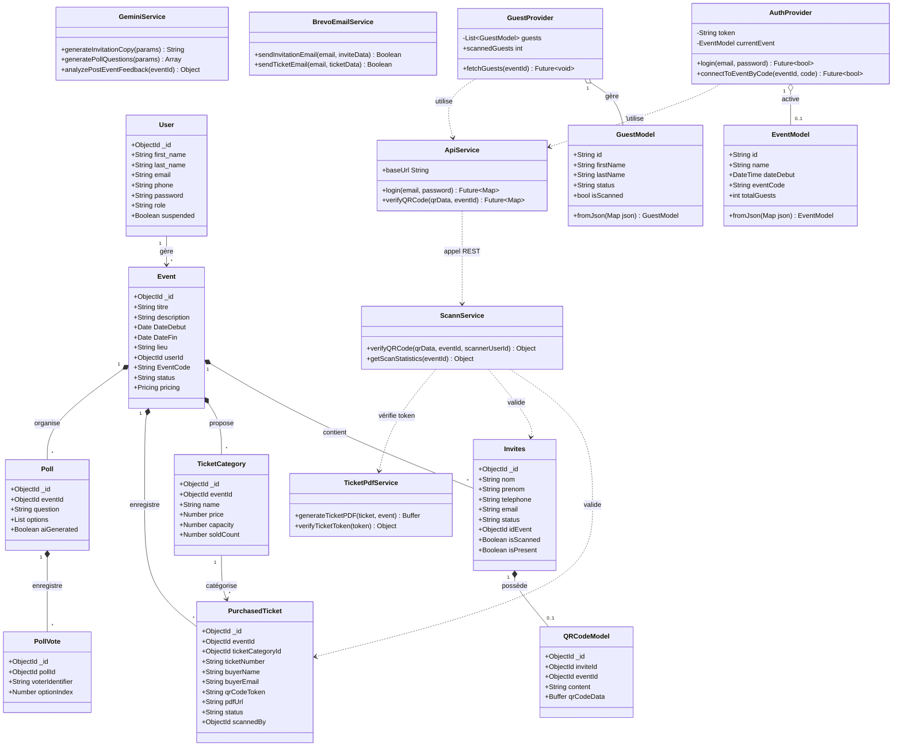

# Diagramme de Classes UML 2.5 - Architecture Logicielle ARSHI EVENT

Ce document présente l'analyse UML 2.5 complète et rigoureuse de la structure logicielle du système **ARSHI EVENT**, englobant :
1. **L'Architecture Backend Node.js / Express** (Entités de Domaine Mongoose, Contrôleurs REST, Middlewares et Services Métier / IA).
2. **L'Architecture Client Mobile Flutter / Dart** (Modèles de données client, Providers de gestion d'état réactif `ChangeNotifier` et Services d'API / Scan).
3. **La Légende des Notations UML 2.5**, la matrice des relations et cardinalités, les **Design Patterns** identifiés et les recommandations architecturales.

---

## 1. Légende et Notations Normées UML 2.5

### Visibilités
- `+` **Public** : Accessible depuis n'importe quelle classe du système.
- `-` **Private** : Accessible uniquement à l'intérieur de la classe propriétaire.
- `#` **Protected** : Accessible par la classe et ses sous-classes héritées.
- `~` **Package / Internal** : Accessible uniquement dans le même module/package.

### Stéréotypes UML
- `<<entity>>` : Modèle de données / Schéma de persistance (Mongoose ou Modèle Dart).
- `<<controller>>` : Composant gérant les requêtes HTTP / API REST.
- `<<service>>` : Composant de logique métier, d'intégration système ou d'IA.
- `<<provider>>` : Gestionnaire d'état réactif côté application mobile.
- `<<middleware>>` : Intercepteur de sécurité, de contrôle d'accès ou de traitement de fichiers.

### Types de Relations UML 2.5
| Symbolisme PlantUML | Symbolisme Mermaid | Type de Relation | Description |
| :---: | :---: | :--- | :--- |
| `A <|-- B` | `A <|-- B` | **Héritage / Généralisation** | B hérite des propriétés et méthodes de la classe A. |
| `Interface <|.. B` | `Interface <|.. B` | **Implémentation** | B implémente le contrat d'interface défini. |
| `A *-- B` | `A "1" *-- "*" B` | **Composition** | B appartient exclusivement à A (destruction en cascade si A disparaît). |
| `A o-- B` | `A "1" o-- "*" B` | **Agrégation** | B fait partie du groupe A mais possède son propre cycle de vie indépendant. |
| `A --> B` | `A "1" --> "*" B` | **Association Orientée** | A détient une référence vers B pour son fonctionnement. |
| `A ..> B` | `A ..> B` | **Dépendance** | A utilise temporairement B (ex: passage de paramètre ou appel de service statique). |

---

## 2. Diagramme de Classes Général (PlantUML)

---

## 3. Diagramme de Classes Général (Mermaid.js)

---

## 4. Description Détaillée des Classes et Packages

### A. Package `Backend::DomainEntities`

#### 1. `User` `<<entity>>`
- **Rôle** : Représente un compte utilisateur (Organisateur d'événement ou Administrateur système).
- **Attributs clés** :
  - `+ObjectId _id` : Identifiant MongoDB.
  - `+String email` : Email unique servant d'identifiant de connexion.
  - `+String password` : Mot de passe haché (Bcrypt).
  - `+String role` : Rôle d'accès (`'user'` | `'admin'`).
  - `+Boolean suspended` : État de suspension.

#### 2. `Event` `<<entity>>`
- **Rôle** : Représente un événement créé par un organisateur.
- **Attributs clés** :
  - `+String titre`, `+String description`, `+String lieu` : Informations publiques.
  - `+Date DateDebut`, `+Date DateFin` : Dates de déroulement.
  - `+ObjectId userId` : Référence vers le créateur (`ref: 'user'`).
  - `+String EventCode` : Code secret alphanumérique à 8 caractères pour la connexion des agents de contrôle mobile.
  - `+Pricing pricing` : Configuration des frais et tarifs de billetterie.

#### 3. `Invites` `<<entity>>`
- **Rôle** : Fiche d'un participant invité à un événement privé.
- **Attributs clés** :
  - `+String nom`, `+String prenom`, `+String email`, `+String telephone` : Coordonnées.
  - `+String status` : Catégorie d'accès (`'vip'` | `'classique'`).
  - `+Boolean isScanned`, `+Boolean isPresent` : État du contrôle d'accès en temps réel.

#### 4. `PurchasedTicket` `<<entity>>`
- **Rôle** : Billet individuel acheté lors d'un événement public.
- **Attributs clés** :
  - `+String ticketNumber` : Numéro unique d'identification du billet.
  - `+String qrCodeToken` : Jeton JWT encodé dans le QR Code anti-fraude.
  - `+String pdfUrl` : Lien de téléchargement du billet PDF.
  - `+String status` : État du billet (`'valid'`, `'scanned'`, `'cancelled'`).

---

### B. Package `Backend::Services`

#### 1. `ScannService` `<<service>>`
- **Rôle** : Moteur central de contrôle d'accès anti-fraude et de validation atomique des QR Codes (Événements privés et publics).
- **Méthodes clés** :
  - `+verifyQRCode({ qrData, eventId, scannerUserId })` : Décode le jeton, vérifie l'unicité et marque le billet/invité comme scanné.
  - `+getScanStatistics(eventId)` : Calcule le taux de présence et les statistiques en temps réel.

#### 2. `GeminiService` `<<service>>`
- **Rôle** : Intégration de l'IA Générative Google Gemini pour l'événementiel.
- **Méthodes clés** :
  - `+generateInvitationCopy(params)` : Génère des textes d'invitation personnalisés selon le ton (Luxe, Festif, Officiel).
  - `+generatePollQuestions(params)` : Crée automatiquement des questions de sondage adaptées au thème.
  - `+analyzePostEventFeedback(eventId)` : Génère un rapport d'analyse de sentiment sur les retours des participants.

#### 3. `TicketPdfService` `<<service>>`
- **Rôle** : Génération visuelle et sécurisée des billets PDF et signature des jetons.
- **Méthodes clés** :
  - `+generateTicketPDF(ticket, event)` : Génère le fichier binaire PDF du billet avec QR Code.
  - `+generateTicketToken(ticketId)` : Signe un jeton cryptographique JWT anti-contrefaçon.

---

### C. Package `MobileApp::FlutterClient`

#### 1. `AuthProvider` `<<provider>>`
- **Rôle** : Gestionnaire d'état de session utilisateur et de connexion par `EventCode` sur l'application mobile de contrôle d'accès.

#### 2. `GuestProvider` `<<provider>>`
- **Rôle** : Gestionnaire de l'état réactif de la liste des invités, du filtrage et de la mise à jour instantanée des scans.

#### 3. `ApiService` `<<service>>`
- **Rôle** : Couche d'abstraction réseau HTTP effectuant les appels REST vers les endpoints Node.js (`/api/scan/verify`, `/api/auth/login`, etc.).

---

## 5. Matrice des Relations et Cardinalités UML 2.5

| Classe Source | Multiplicité | Type de Relation | Classe Cible | Multiplicité | Description & Rôle Métier |
| :--- | :---: | :---: | :--- | :---: | :--- |
| **User** | `1` | Association `-->` | **Event** | `*` | Un organisateur peut créer plusieurs événements. |
| **Event** | `1` | Composition `*--` | **Invites** | `*` | Les invités appartiennent exclusivement à un événement. |
| **Event** | `1` | Composition `*--` | **TicketCategory** | `*` | Un événement définit ses catégories de billets publics. |
| **Event** | `1` | Composition `*--` | **PurchasedTicket** | `*` | Un événement enregistre les billets achetés. |
| **Event** | `1` | Composition `*--` | **Poll** | `*` | Un événement organise des sondages interactifs. |
| **Invites** | `1` | Composition `*--` | **QRCodeModel** | `0..1` | Un invité possède au plus un QR Code de contrôle d'accès. |
| **TicketCategory** | `1` | Association `-->` | **PurchasedTicket** | `*` | Une catégorie regroupe plusieurs billets acheteurs. |
| **Poll** | `1` | Composition `*--` | **PollVote** | `*` | Un sondage enregistre l'ensemble de ses votes. |
| **ScannController** | `1` | Dépendance `..>` | **ScannService** | `1` | Le contrôleur délègue la logique de scan au service métier. |
| **ScannService** | `1` | Dépendance `..>` | **TicketPdfService** | `1` | Le service de scan valide la signature JWT du billet. |
| **AuthProvider** | `1` | Agrégation `o--` | **EventModel** | `0..1` | L'AuthProvider maintient l'événement sélectionné en cours. |
| **GuestProvider** | `1` | Agrégation `o--` | **GuestModel** | `*` | Le GuestProvider conserve la liste en mémoire des invités. |

---

## 6. Design Patterns Identifiés

1. **Architecture MVC (Model-View-Controller)** :
   - Découpage strict entre la persistance (`models/`), la gestion des flux REST (`controller/`) et l'affichage web/mobile.
2. **Provider / Observer Pattern (Gestion d'État Flutter)** :
   - Utilisation de `ChangeNotifier` et `ListenableBuilder` côté Flutter pour notifier réactivement les écrans lors d'un scan ou d'une authentification.
3. **Service Layer Pattern (Couche Métier Abstraite)** :
   - Isolation complète des règles métiers et transactions dans la couche `services/` (`ScannService`, `GeminiService`, `PricingService`), garantissant la réutilisabilité et la testabilité.
4. **Singleton Pattern (Services Réseau et Base de Données)** :
   - L'instance de connexion Mongoose ainsi que les instances de services de stockage local et HTTP sont réutilisées de manière unique sur le cycle de vie de l'application.
5. **Middleware Chain / Interceptor Pattern** :
   - Pipeline de traitement des requêtes HTTP Express via des middlewares réutilisables : authentification JWT (`authmiddlewre.js`), limitation de débit (`rateLimit.js`), et gestion de fichiers (`upload.js`).
6. **Scheduled Worker Pattern** :
   - Tâches automatisées en arrière-plan (`dailyReminderScheduler`, `eventStatusScheduler`) pour les rappels automatiques et la mise à jour des statuts d'événements.

---

## 7. Recommandations Architecturales

1. **Introduction d'une Façade IA (`AiFacadeService`)** :
   - *Constat* : Les appels à Gemini sont répartis dans plusieurs services spécialisés (`pollAiService`, `reminderAiService`, `feedbackAiService`).
   - *Recommandation* : Regrouper l'accès à l'API Gemini sous un pattern **Façade** pour centraliser la gestion du rate-limiting, des clés API et du fallback.
2. **Standardisation des Interfaces de Notification** :
   - *Constat* : L'envoi des invitations utilise parfois Brevo, WhatsApp ou Resend.
   - *Recommandation* : Définir une interface `INotificationProvider` avec méthode `send()` implémentée par `BrevoEmailProvider`, `WhatsAppProvider` et `ResendProvider` (**Strategy Pattern**).
3. **Découplage événementiel (Event-Driven Architecture)** :
   - *Constat* : Lorsqu'un scan réussit, `ScannService` effectue de manière synchrone la mise à jour de la base et l'envoi d'une notification.
   - *Recommandation* : Émettre un événement `TicketScannedEvent` auquel s'abonnent le service de notification et de statistique pour améliorer le temps de réponse du scan mobile.
