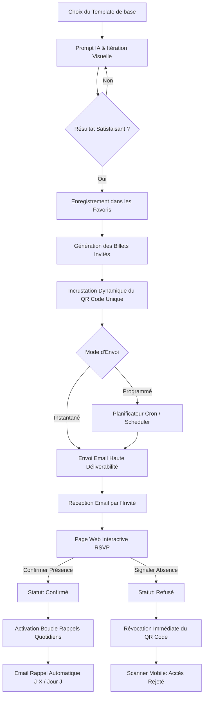

# 🎯 Cahier des Charges & Plan d'Action Technique : Génération d'Invitations IA, Diffusion & Gestion RSVP

> **Projet :** Plateforme Intelligente de Gestion d'Événements & Billetterie IA  
> **Auteur :** Lead Ingénieur Fullstack & Creative Technologist  
> **Statut :** Plan d'action validé pour implémentation progressive

---

## 🌟 1. Vue d'Ensemble & Vision du Système

L'objectif est d'offrir une expérience bout-en-bout haute-fidélité pour la création, la personnalisation, l'envoi et le suivi des invitations d'événements :
1. **Personnalisation par IA (Flux / Imagen)** : L'organisateur choisit un modèle de départ, le modifie par des prompts en langage naturel, affine le rendu visuel jusqu'à satisfaction, puis l'enregistre dans ses favoris.
2. **Composition Haute Résolution** : Le système génère automatiquement pour chaque invité un billet personnalisé intégrant son QR code unique et ses informations.
3. **Diffusion Multicanale Maîtrisée** : Envoi instantané ou différé/programmé par email professionnel (design responsive, haute délivrabilité, bypass du blocage d'images Gmail).
4. **RSVP Interactif & Sécurité QR Code** : L'invité confirme ou refuse sa présence via une interface dédiée. En cas d'absence, le QR code est **immédiatement invalidé** pour le scanner.
5. **Rappels Automatiques Quotidiens** : Système de cron intelligent envoyant des rappels personnalisés aux seuls invités confirmés jusqu'au jour de l'événement.

---

## 🗺️ 2. Diagramme d'Architecture & Flux de Données



---

## 📋 3. Plan d'Implémentation Étape par Étape

---

### 🎨 Phase 1 : Pipeline IA de Génération & Affinage des Billets (Flux / Imagen)

#### 1.1 Objectifs
- Permettre à l'utilisateur de sélectionner un template existant et de le personnaliser par prompt IA.
- Supporter le raffinement itératif (Image-to-Image / Text-to-Image) jusqu'au résultat parfait.
- Permettre la sauvegarde du visuel généré dans les favoris de l'utilisateur.

#### 1.2 Modèles de Données (Mongoose)
```javascript
// models/templates/FavoriteTemplate.js
const favoriteTemplateSchema = new mongoose.Schema({
  userId: { type: mongoose.Schema.Types.ObjectId, ref: 'User', required: true },
  eventId: { type: mongoose.Schema.Types.ObjectId, ref: 'Event' },
  titre: { type: String, required: true },
  imageUrl: { type: String, required: true },
  cloudinaryPublicId: { type: String },
  promptHistorique: [{
    prompt: String,
    generatedAt: { type: Date, default: Date.now },
    aspectRatio: String
  }],
  metadata: {
    theme: String,
    palette: [String],
    aspectRatio: { type: String, default: '16:9' }
  },
  createdAt: { type: Date, default: Date.now }
});
```

#### 1.3 Endpoints API
| Méthode | Route | Description |
| :--- | :--- | :--- |
| `POST` | `/api/ia/generate-ticket` | Génère un visuel initial selon un prompt et un style |
| `POST` | `/api/ia/refine-ticket` | Modifie un billet existant avec de nouvelles instructions |
| `POST` | `/api/templates/favorites` | Sauvegarde le billet dans les favoris de l'utilisateur |
| `GET` | `/api/templates/favorites` | Récupère la liste des templates favoris de l'utilisateur |
| `DELETE`| `/api/templates/favorites/:id`| Supprime un template des favoris |

---

### 🖼️ Phase 2 : Moteur de Composition Graphique (Billet + QR Code)

#### 2.1 Objectifs
- Associer chaque invité de l'événement au template favori sélectionné.
- Générer un QR Code unique contenant l'identifiant sécurisé de l'invité (`inviteId`, `eventId`, `token de signature`).
- Composer l'invitation finale (fond billet haute résolution + calque QR Code + cartouche texte personnalisé).

#### 2.2 Pipeline Technique de Composition
1. Récupération du billet haute définition sur Cloudinary.
2. Génération du QR code vectoriel ou PNG haute résolution.
3. Assemblage des calques via `Sharp` ou `Canvas` côté backend.
4. Upload de l'invitation composée sur Cloudinary (`folder: invitations/final/`).
5. Mise à jour de l'objet `Invitation` dans MongoDB.

#### 2.3 Mise à jour du Modèle `Invitation`
```javascript
// Mise à jour du schéma models/invitation/invitation.js
{
  finalInvitationUrl: { type: String }, // Image complète assemblée
  qrCodeUrl: { type: String, required: true }, // QR Code hébergé
  qrDataToken: { type: String, unique: true }, // Token unique sécurisé
  templateFavoriteId: { type: mongoose.Schema.Types.ObjectId, ref: 'FavoriteTemplate' },
  isRevoked: { type: Boolean, default: false }, // QR code invalidé si absence
  rsvpStatus: { 
    type: String, 
    enum: ['en attente', 'confirmé', 'refusé'], 
    default: 'en attente' 
  },
  rsvpUpdatedAt: { type: Date }
}
```

---

### 🚀 Phase 3 : Diffusion Multicanale & Refonte Email Haute Fidélité

#### 3.1 Objectifs
- Permettre l'envoi immédiat ou la programmation à une date/heure ultérieure.
- Concevoir un template d'email cinématique et responsive (Dark & Light luxury).
- Éviter le blocage des images Gmail en hébergeant le QR Code et le Billet sur Cloudinary via de vraies URLs HTTPS.
- Fournir un bouton de téléchargement haute qualité du billet (PNG/PDF).

#### 3.2 Structure de l'Email Professionnel
- **En-tête** : Logo événement & badge statut invité (VIP / Classique).
- **Hero Image** : Billet d'invitation personnalisé haute résolution.
- **Section Accès & QR Code** : QR Code scannable centré avec instructions d'arrivée.
- **Boutons d'Action Clairs (CTA)** :
  - 🟢 **Confirmer ma présence** (Lien magique RSVP)
  - 🔴 **Signaler mon absence** (Lien magique RSVP)
  - 💾 **Télécharger mon Billet** (Téléchargement direct)

#### 3.3 Endpoints API d'Envoi
| Méthode | Route | Description |
| :--- | :--- | :--- |
| `POST` | `/api/invitations/send-instant` | Envoi immédiat aux invités sélectionnés |
| `POST` | `/api/invitations/schedule-send` | Programmation d'un envoi différé (date/heure) |
| `GET` | `/api/invitations/scheduled-jobs` | Liste des envois programmés en attente |
| `DELETE`| `/api/invitations/scheduled-jobs/:id`| Annulation d'un envoi programmé |

---

### 🛡️ Phase 4 : Système de RSVP Interactif & Gestion Sécurisée du QR Code

#### 4.1 Objectifs
- Fournir une page publique légère et élégante accessible via un token sécurisé unique (sans mot de passe).
- Offrir deux choix clairs à l'invité : **Confirmer sa présence** ou **Signaler son absence**.
- En cas de signalement d'absence :
  - `rsvpStatus = 'refusé'`
  - `isRevoked = true`
  - Le QR Code est immédiatement rejeté lors du scan à l'entrée.

#### 4.2 Logique de Sécurité du Scanner (`scannService.js`)
```javascript
// Règle de validation lors du scan :
if (invitation.isRevoked || invitation.rsvpStatus === 'refusé') {
  return {
    success: false,
    accessDenied: true,
    reason: "INVITATION_ANNULEE : L'invité a signalé son absence. QR Code inopérant."
  };
}
```

#### 4.3 Endpoints API RSVP
| Méthode | Route | Description |
| :--- | :--- | :--- |
| `GET` | `/api/rsvp/:token` | Récupère les infos de l'invité pour afficher la page RSVP |
| `POST` | `/api/rsvp/:token/confirm` | Valide la présence (`confirmé`), active les rappels |
| `POST` | `/api/rsvp/:token/decline` | Déclare l'absence (`refusé`), **invalide le QR Code** |

---

### ⏰ Phase 5 : Smart Scheduler & Boucle de Rappels Quotidiens Automatisés

#### 5.1 Objectifs
- Exécuter une tâche cron quotidienne (ex: tous les matins à 08h00).
- Sélectionner les événements à venir et les invités dont le statut est `confirmé`.
- Envoyer des rappels dynamiques et contextualisés (J-7, J-3, J-1, Jour J).

#### 5.2 Règles de Gestion des Rappels
```javascript
// services/dailyReminderScheduler.js
// 1. Calcul du delta en jours : (DateDebut - Aujourd'hui)
// 2. Condition d'éligibilité :
//    - invitation.rsvpStatus === 'confirmé'
//    - invitation.isRevoked === false
//    - Dernier rappel non envoyé aujourd'hui
// 3. Contenu adapté au délai (ex: "J-1 : Préparez votre QR code pour demain !")
```

---

## 🗂️ 4. Matrice de Progression & Ordre de Développement

```
[Phase 1 : IA Ticket Studio] ─────────► [Phase 2 : Compositeur Visuel]
                                                  │
                                                  ▼
[Phase 4 : Module RSVP & Sécurité QR] ◄── [Phase 3 : Diffusion & Email Pro]
               │
               ▼
[Phase 5 : Cron Rappels Quotidiens] ────► [Recette & Déploiement]
```

| Étape | Livrables Backend | Dépendances | Risques & Points de Vigilance |
| :--- | :--- | :--- | :--- |
| **Phase 1** | Routes IA, Service Gemini/Flux, Modèle Favoris | Clés API Flux/Gemini | Temps de réponse IA, gestion du format image |
| **Phase 2** | Service de composition Sharp, Stockage Cloudinary | Phase 1 | Alignement pixel-perfect du QR code |
| **Phase 3** | Service Brevo Email Pro, Scheduler d'envois | Phase 2 | Délivrabilité email, formats responsive |
| **Phase 4** | Routes publiques RSVP, Invalidation QR dans `scannService` | Phase 2, 3 | Sécurité du token, scan temps réel |
| **Phase 5** | Cron `dailyReminderScheduler`, Anti-spam logs | Phase 3, 4 | Éviter les envois multiples |

---

## ✅ 5. Critères d'Acceptation & Validation

1. **Génération IA** : Le template modifié correspond aux instructions textuelles de l'utilisateur et peut être sauvegardé en favori.
2. **Invitation Unique** : Chaque invité reçoit un visuel haute résolution avec son QR code dédié.
3. **Planification** : Les invitations peuvent partir immédiatement ou à l'heure programmée.
4. **Validation Scanner** : Un invité ayant refusé son invitation voit son QR code refusé au scan avec un message explicite.
5. **Rappels** : Seuls les invités confirmés reçoivent les rappels quotidiens automatisés jusqu'au jour de l'événement.