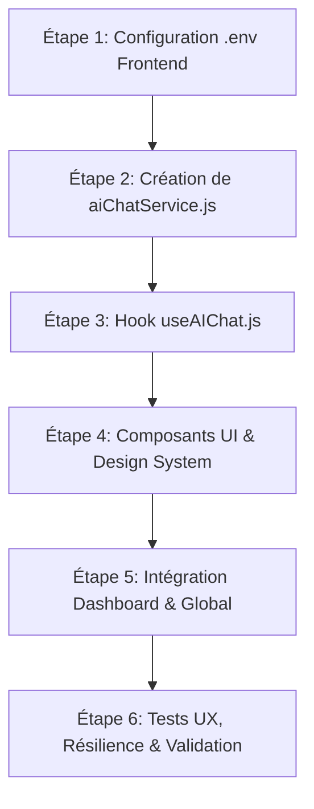

si l'utilisateur demande une integration coter frontend je veux que tu suis le workflow suivant :

pose lui la question suivante : "voulez vous une integration complete ?" si il repon oui  alors tu respecte le workflow suivant en l'adaptent au composant deja concu :

# 📋 Workflow d'Intégration Frontend — Chatbot IA Gemini

Ce document détaille le workflow complet pour l'intégration d'un assistant conversationnel IA fluide, moderne et robuste côté frontend (React / Vite), connecté au microservice Express (`http://localhost:5000/api/chat`).

---

## 🎯 1. Objectifs & Périmètre Fonctionnel

- **Conversation fluide multi-tours** : L'utilisateur dialogue avec l'IA qui conserve l'historique et le contexte grâce au `sessionId`.
- **Persistance locale de session** : Maintien du `sessionId` et de l'historique des échanges en `sessionStorage` ou `localStorage` pour éviter la perte de contexte en cas de rafraîchissement de page.
- **Expérience Utilisateur (UX) Premium** :
  - Animations soignées et indicateur de frappe (*typing indicator*).
  - Rendu Markdown riche (listes à puces, gras, italique, blocs de code).
  - Boutons de suggestions rapides (*Quick Prompts / Pills*).
  - Bouton de réinitialisation de la conversation (*Reset Session*).
  - Bouton de copie du contenu des réponses dans le presse-papier.
  - Défilement automatique (*auto-scroll*) vers le dernier message.
- **Résilience réseau & Sécurité** :
  - Gestion claire des statuts (chargement, erreur quota 429, timeout, déconnexion).
  - Aucune clé d'API exposée côté client (tous les flux transitent par l'API backend).

---

## 🏗️ 2. Architecture Frontend Cible
 c'est dans le dossier "personnalisation/IntelligentDesign.jsx" que l'interface du chat est implementer, donc tu vas adapter ce workflow a l'interface deja existante.
```
reactProjet/my_app/src/
├── services/
│   └── aiChatService.js             # Client HTTP (Axios) pour l'API /api/chat
├── hooks/
│   └── useAIChat.js                 # Hook personnalisé d'état et de logique conversationnelle
├── components/
│   └── dashboard/
│       └── aiChat/
│           ├── AIChatWidget.jsx     # Bouton flottant déclencheur + Drawer / Modale
│           ├── AIChatWindow.jsx     # Conteneur principal de la fenêtre de chat
│           ├── AIChatHeader.jsx     # En-tête avec statut du serveur et bouton Reset
│           ├── AIChatMessageList.jsx# Liste des messages avec auto-scroll
│           ├── AIChatMessageItem.jsx# Bulle de message (Utilisateur / Assistant avec Markdown)
│           └── AIChatInput.jsx      # Barre de saisie avec suggestions rapides
└── config/
    └── api.js                       # Configuration des URLs d'API (VITE_AI_API_URL)
```

---

## ⚙️ 3. Spécifications par Couche

### 3.1 Couche Configuration (`.env` & `config/api.js`)
- Définir l'URL de base du service IA dans le fichier `.env` du frontend :
  ```env
  VITE_AI_API_URL=http://localhost:5000/api/chat
  ```
- Créer un point d'accès centralisé pour basculer facilement entre environnement local et production.

---

### 3.2 Couche Service (`src/services/aiChatService.js`)
- Exposer 3 fonctions asynchrones :
  1. `sendMessage(sessionId, message)` : Effectue un `POST /api/chat` avec `{ sessionId, message }`.
  2. `resetSession(sessionId)` : Effectue un `POST /api/chat/reset` avec `{ sessionId }`.
  3. `checkHealth()` : Effectue un `GET /api/chat/health` pour vérifier l'état du modèle et la connectivité.
- Intercepter et normaliser les erreurs HTTP (400, 429, 500, erreur réseau).

---

### 3.3 Couche Logique & État (`src/hooks/useAIChat.js`)
- **États gérés** :
  - `messages` : Tableau d'objets `{ id, type: 'user' | 'assistant', content, timestamp }`.
  - `sessionId` : Identifiant UUID persistant (généré à l'initialisation ou récupéré du stockage).
  - `isLoading` : Booléen indiquant si l'IA génère sa réponse.
  - `error` : Message d'erreur formaté pour l'utilisateur en cas de souci.
  - `isOnline` : Statut de disponibilité du service backend.
- **Fonctions exposées** :
  - `send(text)` : Ajoute le message utilisateur, appelle l'API, ajoute la réponse reçue.
  - `reset()` : Réinitialise l'historique local et appelle l'API de reset backend.
  - `clearError()` : Réinitialise l'état d'erreur.

---

### 3.4 Couche Présentation & Composants UI

#### A. `AIChatWidget.jsx`
- Bouton flottant moderne en bas à droite de l'écran avec badge discret et micro-animation.
- Ouvre un panneau latéral (*Drawer*) ou une modale élégante sans bloquer le reste de l'application.

#### B. `AIChatHeader.jsx`
- Titre : **"Assistant IA ArshiEvent"**.
- Indicateur de statut vert clignotant (*En ligne* / *Modèle Gemini actif*).
- Bouton poubelle / rafraîchir pour réinitialiser la conversation.
- Bouton de fermeture.

#### C. `AIChatMessageList.jsx` & `AIChatMessageItem.jsx`
- Bulles de dialogue distinctes :
  - **Utilisateur** : Fond bleu / accent, aligné à droite.
  - **Assistant IA** : Fond blanc avec bordure subtile, icône Sparkles, aligné à gauche.
- Animation de frappe avec 3 points sautillants (*bouncing dots*) pendant `isLoading`.
- Bouton "Copier" en survol pour copier le texte généré par l'IA.

#### D. `AIChatInput.jsx`
- Zone de saisie extensible avec touche Entrée pour envoyer (Maj+Entrée pour un saut de ligne).
- Pilules de suggestions cliquables :
  - *"Idées de thèmes pour une soirée gala"*
  - *"Rédiger un texte d'invitation VIP"*
  - *"Conseils pour organiser le planning"*
- Bouton d'envoi dynamique qui se désactive pendant la génération.

---

## 📅 4. Plan d'Exécution Étape par Étape



### Étape 1 : Configuration des variables d'environnement
- Ajouter `VITE_AI_API_URL=http://localhost:5000/api/chat` dans le fichier `.env` du frontend.

### Étape 2 : Implémentation du service API (`aiChatService.js`)
- Créer le client HTTP Axios avec configuration des headers JSON et timeouts.

### Étape 3 : Implémentation du hook React (`useAIChat.js`)
- Gestion du cycle de vie du `sessionId` via `crypto.randomUUID()`.
- Synchronisation avec `sessionStorage` pour persister l'historique lors des navigations entre onglets.

### Étape 4 : Développement des composants UI
- Créer l'arborescence des composants sous `src/components/dashboard/aiChat/`.
- Appliquer les styles Vanilla CSS / Tailwind du projet (glassmorphism, typographie moderne, dark/light mode harmonieux).

### Étape 5 : Intégration dans l'application
- Intégrer le widget flottant dans la disposition principale du tableau de bord (`DashboardLayout` ou équivalent).
- Rendre le composant accessible depuis toutes les pages d'administration d'événements.

### Étape 6 : Tests et Validation
1. **Test d'envoi & réponse** : Vérifier que les messages s'affichent instantanément et que la réponse de l'IA arrive sans latence superflue.
2. **Test du contexte conversationnel** : Poser une question, puis y faire référence dans le message suivant.
3. **Test de réinitialisation** : Cliquer sur le bouton Reset et vérifier que le contexte repart à zéro.
4. **Test de coupure serveur** : Couper temporairement le port 5000 et vérifier que l'UI affiche un message convivial (sans crash React).

---

## 🛡️ 5. Critères d'Acceptation & Validation

1. ✅ Le composant de chat s'intègre harmonieusement dans l'interface sans aucun décalage visuel (*Pixel Perfect*).
2. ✅ La persistance du contexte fonctionne sur plusieurs échanges consécutifs.
3. ✅ Le rafraîchissement de la page ne fait pas perdre la session en cours.
4. ✅ En cas d'erreur réseau ou de quota dépassé, l'utilisateur voit un message explicite et bienveillant.
5. ✅ La compilation frontend `npm run build` passe avec 0 erreur.
